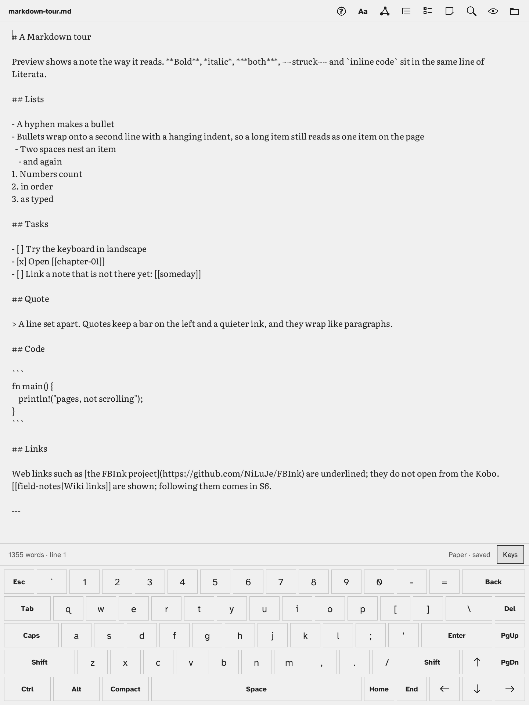
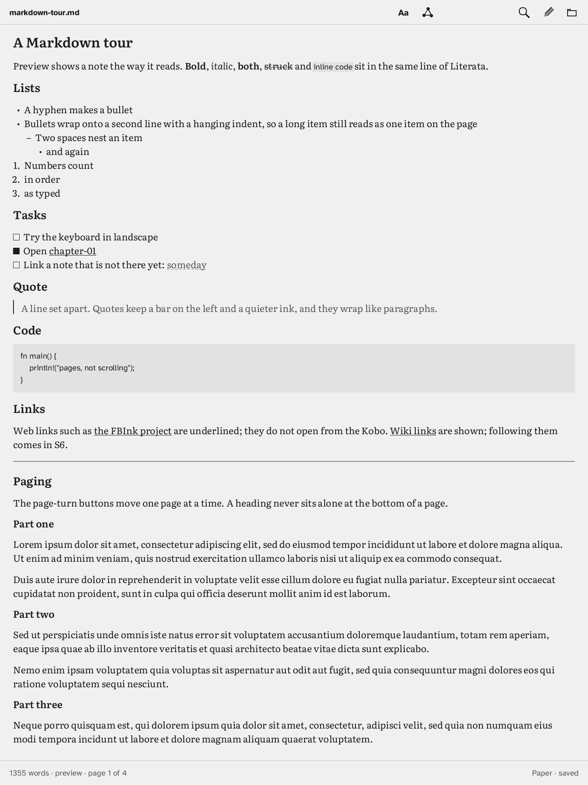
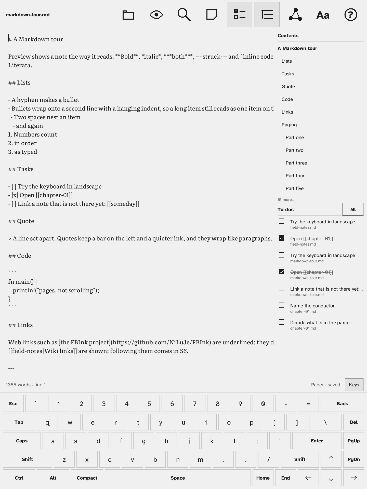
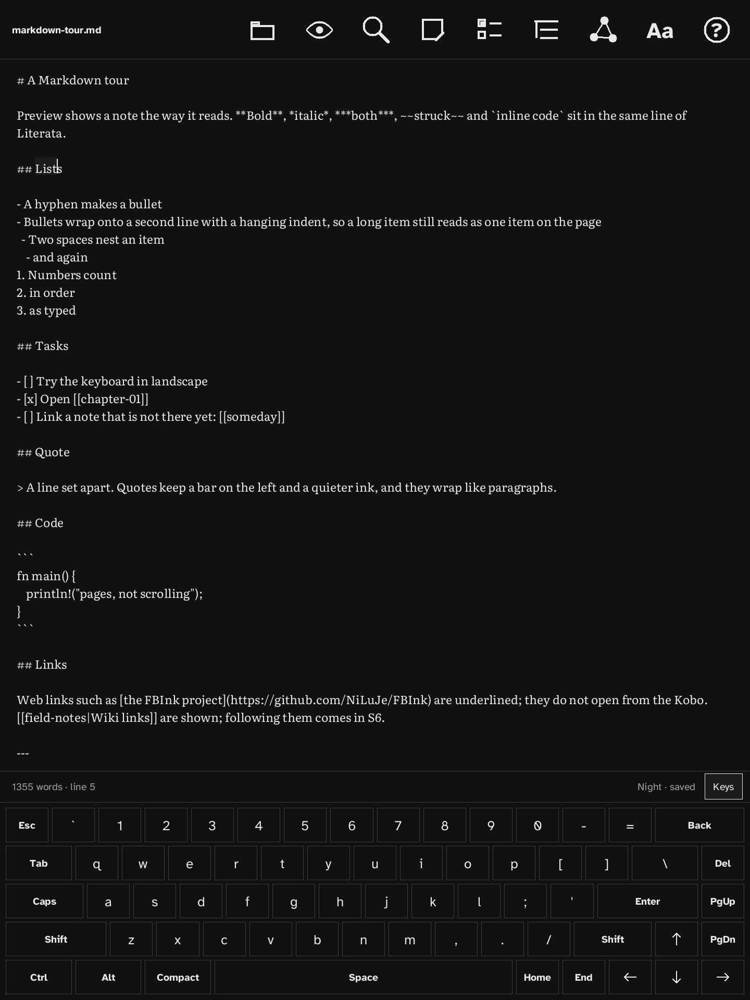
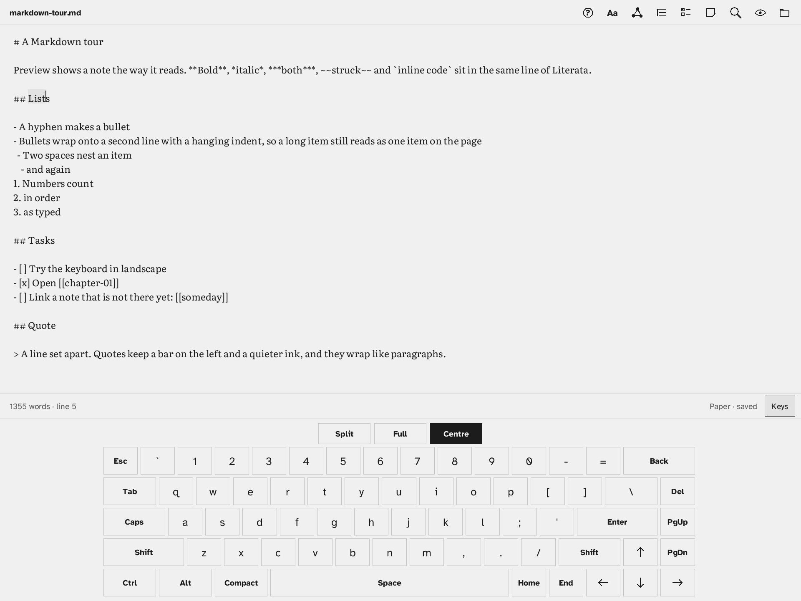

# Sigma Scribe

A distraction-free Markdown notebook for the **Kobo Forma** — native Rust, drawn with [FBInk](https://github.com/NiLuJe/FBInk), launched from [NickelMenu](https://github.com/pgaskin/NickelMenu). Notes are plain `.md` files you can reach over USB.

Licence: **AGPL-3.0-only** (`LICENSE`) · Author: **Sigma Recon** · Statically links FBInk (GPL-3.0-or-later) · Fonts: Literata and Atkinson Hyperlegible (SIL OFL 1.1) — see `packaging/kobo/.adds/sigma-scribe/THIRD-PARTY.txt`.

Status: **v1.0.0 release candidate — not yet tested on the device and not released.** The last version that passed on the Forma is v0.4.0. Tested model/firmware: Kobo Forma, 4.38.23697.

| Write | Preview | Drawer | Night | Landscape |
|---|---|---|---|---|
|  |  |  |  |  |

## Features
- Editor with an on-screen keyboard (Compact / Full, landscape Split / Full / Centre), touch selection, undo, autosave.
- Library of notes and folders; Markdown preview with pages; wiki links `[[note]]`, backlinks, a graph map of notes and links (or a list).
- Side drawer: Contents, To-dos across all notes, Scratch pad. Find & Replace.
- Options: Paper / Night, Literata or Atkinson, Line mode (words per line), size, leading, margin, tab, keyboard tone, landscape.
- Help pages. USB keyboard (US layout) and mouse/touchpad over USB-OTG with a powered hub or powered OTG cable.

## Install, update, uninstall
See [`docs/install.md`](docs/install.md). In short: install NickelMenu, unpack `sigma-scribe-<ver>-kobo.tar.gz` onto the Kobo drive's root, eject, then *Sigma Scribe* is in the NickelMenu. Notes live in `sigma-scribe/notes` on the drive. Uninstall = delete `.adds/sigma-scribe` and `.adds/nm/sigma-scribe`.

## Run it on your desktop
```sh
scripts/sim.sh            # live window, 1440x1920 scaled to fit
scripts/sim.sh --eink     # with e-ink flash/ghosting look
scripts/sim.sh --headless tests/emu/v1.0-tour.script docs/screenshots/v1.0   # PNGs, no window
cargo test --workspace
```
Window controls: mouse = touch, PageUp/PageDown = page-turn buttons, keyboard = USB keyboard, Esc = power (save & quit).

## Build for the Kobo
`scripts/package-kobo.sh` → `dist/sigma-scribe-<ver>-kobo/` + reproducible `.tar.gz` + `.sha256`, checked by `scripts/check-package.sh`. Release packages are built by `.github/workflows/release.yml` (pinned FBInk); see `docs/release/checklist.md`.

## Docs
`plan.md` · `design-brief.md` · `CHANGELOG.md` · `docs/install.md` · `docs/install-plan-forma.md` · `docs/testing.md` · `docs/usb-keyboard.md` · `docs/perf.md` · `docs/publishing.md` · `docs/release/` · `sprints/` · `tasks/`
