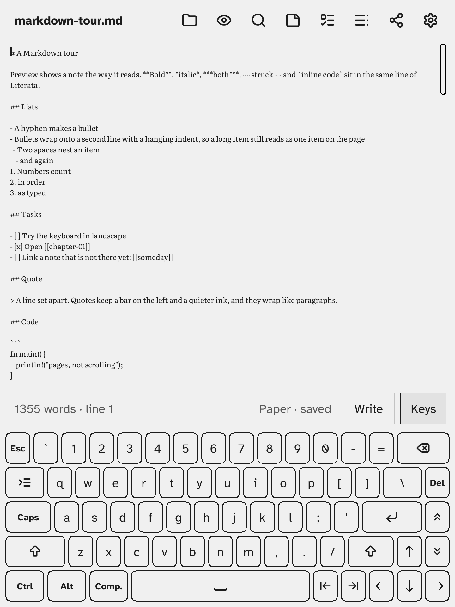
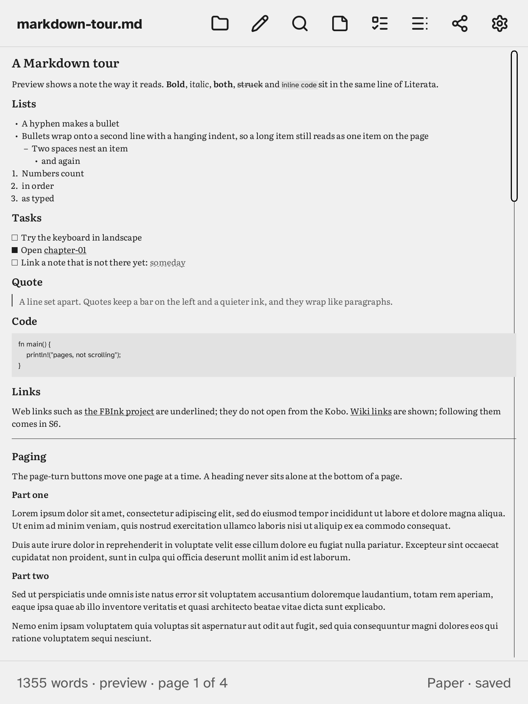
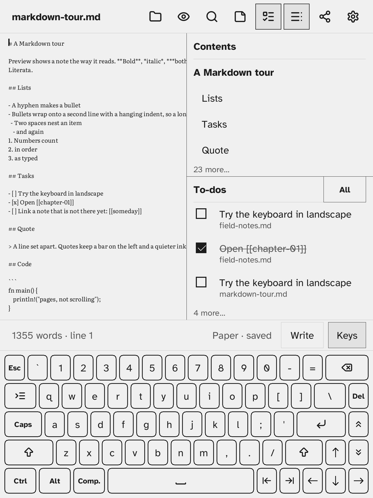
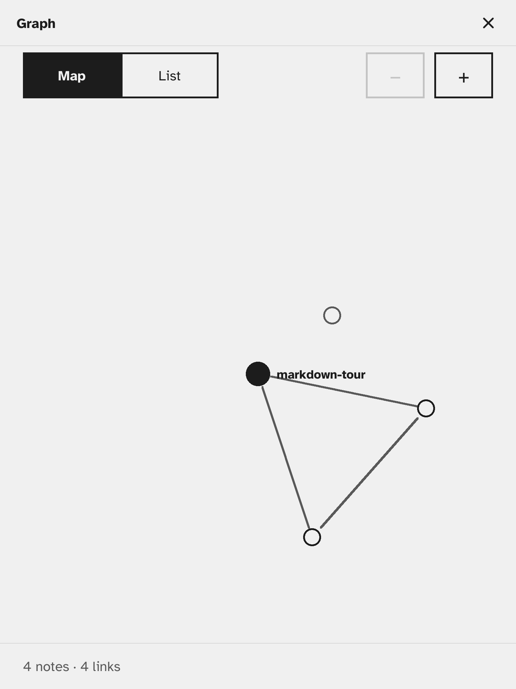
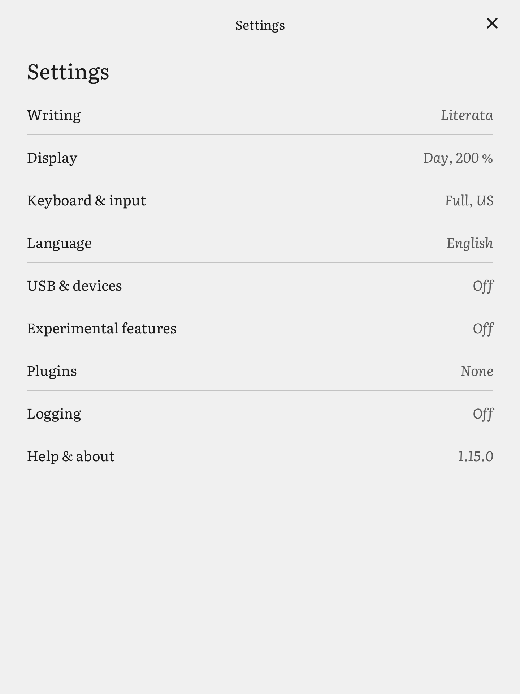
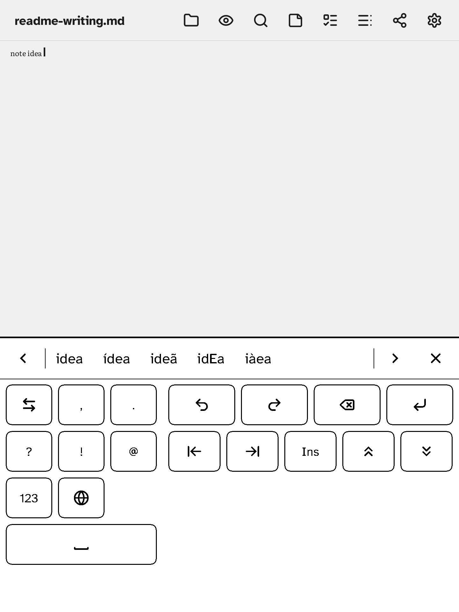
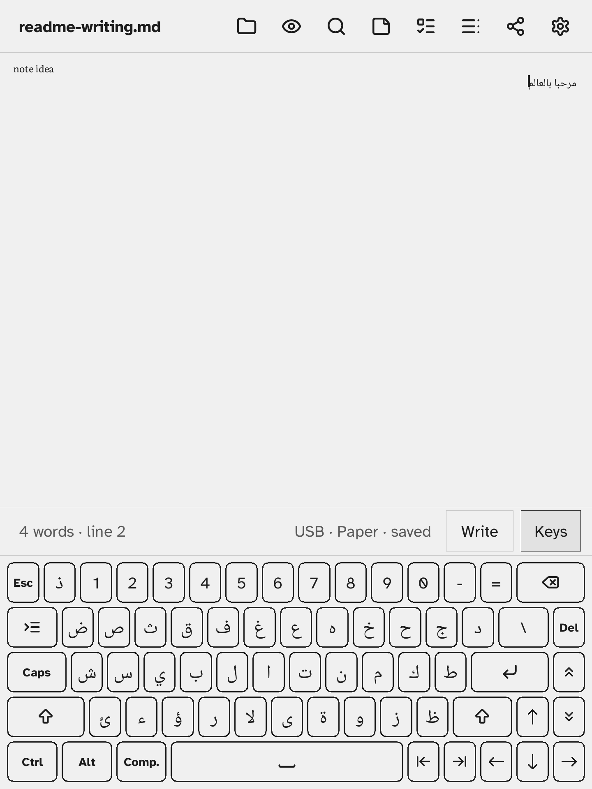
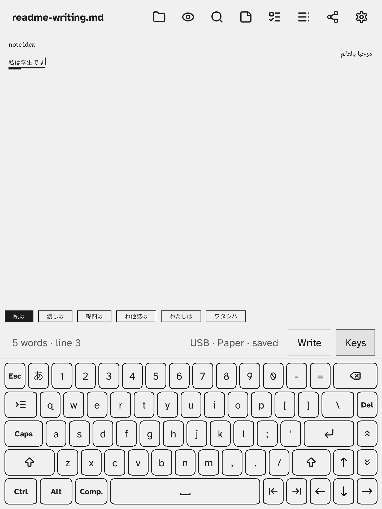
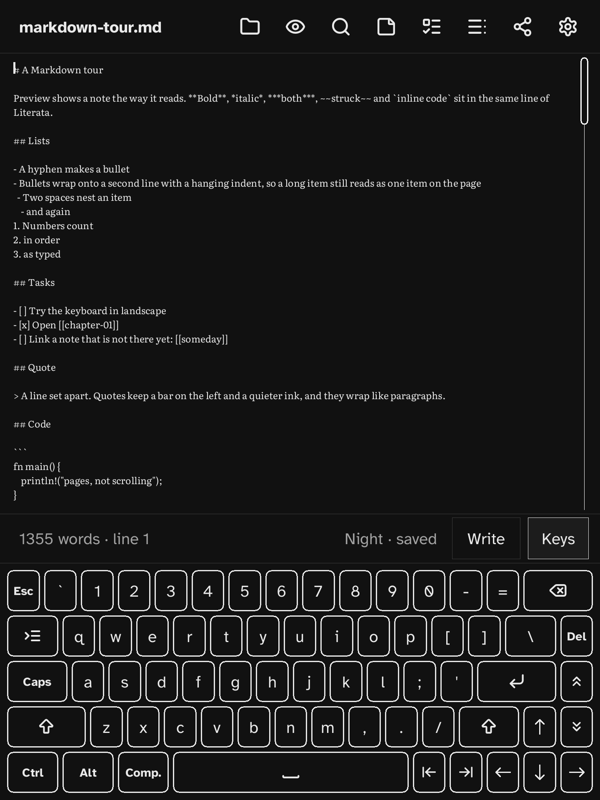
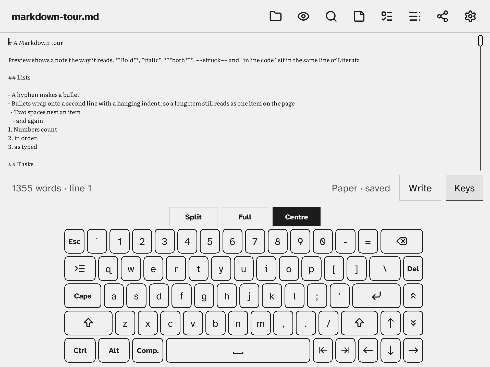

# Σscribe

A distraction-free Markdown notebook for the **Kobo Forma** — native Rust, drawn with [FBInk](https://github.com/NiLuJe/FBInk), launched from [NickelMenu](https://github.com/pgaskin/NickelMenu). Notes are plain `.md` files you can reach over USB. Type on the on-screen keyboard or a USB keyboard, or write by hand.

Licence: **AGPL-3.0-only** (`LICENSE`) · Author: **SIGMArecon** · Statically links FBInk (GPL-3.0-or-later) · Fonts: Literata, Atkinson Hyperlegible and Noto (SIL OFL 1.1) · Icons: [Lucide](https://lucide.dev) (ISC) — see `packaging/kobo/.adds/sigma-scribe/THIRD-PARTY.txt`.

> This repository's git history was cleaned for publication (author identities unified; machine names removed). Device serial numbers are masked as `<FORMA-SERIAL>` in the docs.

Status: **1.15.0**. `CHANGELOG.md` says for each version whether it was tested on the Forma. Tested model/firmware: Kobo Forma, 4.38.23697.

| Write | Preview | Drawer | Graph | Settings |
|---|---|---|---|---|
|  |  |  |  |  |

| Handwriting | Arabic | Japanese | Night | Landscape |
|---|---|---|---|---|
|  |  |  |  |  |

Screenshots from the desktop emulator (`tests/emu/v1.15-readme.script`); e-ink-look copies in [`docs/screenshots/v1.15/eink/`](docs/screenshots/v1.15/eink/), older versions in [`docs/screenshots/`](docs/screenshots/README.md).

## Features

**Writing**
- Editor with an on-screen keyboard: Compact or Full, a size slider, in landscape Split, Full or Centre. A Kobo-style keyboard can be used instead.
- Touch selection with handles, cut / copy / paste, undo and redo, insert or overwrite typing, autosave.
- Find & Replace. Line mode (a set number of words per line), size, leading, margin, tabs.

**Notes**
- A library of notes and folders: new, rename, move, delete (to a `.trash` folder you can copy notes back from). Notes are plain Markdown in `sigma-scribe/notes` on the Kobo drive; nothing else is needed to read them.
- Markdown preview with pages, turned with the page buttons.
- Wiki links `[[note]]` with backlinks; renaming or moving a note updates the links to it.
- A side drawer (drag its grip to set the width, or to the screen edge to tuck it away): the note's **Contents**, **To-dos** across all notes (tick them off from the drawer), and a **Scratch** pad.
- The **Graph**: a map of notes and their links, or a list, with its own settings.

**Handwriting** (Write panel)
- Write anywhere in a blank area. The ink is split into letters and read; spaces come from the gaps. A candidate bar offers other readings, and keys type punctuation, digits and spaces.
- **Word mode** (experimental) reads whole words against a word list and the words in your notes.
- **Letter boxes**, one character per box, as an alternative.
- **Train** the recogniser with samples of your writing. With **Learn from corrections** on, it also keeps learning each time you fix a letter by picking a candidate.
- **Draw**: sketches kept in the note, shown in the preview.
- Gestures: scratch out to erase, flick to delete or add a space.

**Languages**
- Interface in 10 languages: English, French, Portuguese, German, Spanish, Italian, Dutch, Catalan, Danish and Swedish. It follows the Kobo's language, or you can choose one.
- 35 keyboard layouts, on screen and on a USB keyboard, with dead keys and AltGr:
  - **Latin:** US, US International, UK, French, Belgian, German, Spanish, Spanish (Latin America), Portuguese, Portuguese (Brazil), Italian, Danish, Norwegian, Swedish / Finnish, Polish, Czech, Romanian, Turkish.
  - **Cyrillic and Greek:** Russian, Ukrainian, Greek.
  - **Vietnamese:** Telex, VNI.
  - **Right to left:** Arabic, Persian, Urdu, Hebrew, with shaped letters and mixed-direction lines.
  - **Indic and Thai:** Hindi, Marathi, Nepali, Bengali, Tamil, Thai, with conjuncts and clusters.
  - **East Asian:** Korean, Japanese (romaji to kana, kanji conversion with the SKK dictionary), Chinese Simplified and Traditional (pinyin).
- Korean, Japanese and Chinese characters need a font pack (`fonts/cjk.ttf`; see [`docs/font-packs.md`](docs/font-packs.md)). The dictionaries are included.

**Device**
- Paper or Night, Literata or Atkinson Hyperlegible, keyboard tone.
- Portrait and landscape, following the Kobo's accelerometer or set by hand. Backlight control.
- USB keyboard and mouse or touchpad over USB-OTG, through a powered hub or a powered OTG cable.
- Help pages, and Σscribe's files kept out of the Kobo library.

**Plugins**
- WebAssembly plugins in a sandbox, switched on and off in Settings → Plugins, each with its own settings page.
- The Graph and the three drawer panes are plugins, bundled with the app and on by default.
- An optional log file (Settings → Logging) for the app and its plugins.

**Sync**
- Settings → Sync runs Syncthing on the reader while Σscribe is open, to keep the notes folder in step with your computers; no account and no server of ours. Pair by entering the reader's device ID on the computer, then tap Accept on the reader. Off by default; see `docs/sync.md`.

## Install, update, uninstall
See [`docs/install.md`](docs/install.md). In short: install NickelMenu, unpack `sigma-scribe-<ver>-kobo.tar.gz` onto the Kobo drive's root, eject, then *Σscribe* is in the NickelMenu. Notes live in `sigma-scribe/notes` on the drive. An update keeps your notes, settings and plugin choices. Uninstall = delete `.adds/sigma-scribe` and `.adds/nm/sigma-scribe`.

## Run it on your desktop
```sh
scripts/sim.sh            # live window, 1440x1920 scaled to fit
scripts/sim.sh --eink     # with e-ink flash/ghosting look
SIGMA_NOTES=$(mktemp -d) scripts/sim.sh --headless tests/emu/v1.15-readme.script docs/screenshots/v1.15   # PNGs, no window
cargo test --workspace
```
Window controls: mouse = touch, PageUp/PageDown = page-turn buttons, keyboard = USB keyboard, Esc = power (save & quit).

## Build for the Kobo
`scripts/package-kobo.sh` → `dist/sigma-scribe-<ver>-kobo/` + reproducible `.tar.gz` + `.sha256`, checked by `scripts/check-package.sh`. Release packages are built by `.github/workflows/release.yml` (pinned FBInk); see `docs/release/checklist.md`.

## Develop
Rust edition 2021, minimum Rust version in `Cargo.toml` (`rust-version`). Targets: desktop Linux for development and tests, and `armv7-unknown-linux-musleabihf` for the Kobo. Build, check and code conventions are in [`CONTRIBUTING.md`](CONTRIBUTING.md). The handwriting models are built with `tools/hwr-train`.

## Docs
`CONTRIBUTING.md` · `CHANGELOG.md` · `docs/install.md` · `docs/testing.md` · `docs/plugins.md` · `docs/logging.md` · `docs/sync.md` · `docs/font-packs.md` · `docs/japanese.md` · `docs/chinese.md` · `docs/usb-keyboard.md` · `docs/perf.md` · `docs/publishing.md` · `docs/release/`

Planning and working notes (the plan, design brief, sprints, sprint board, device-pass runbooks and session handovers) are in [`.ai/`](.ai/README.md).
