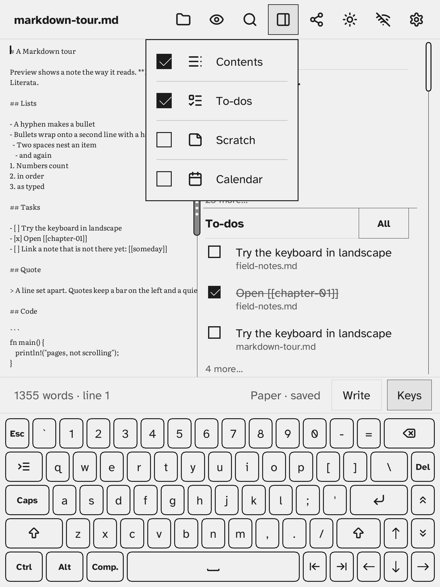

# The drawer and its panes

The **drawer menu**: tick Contents, To-dos, Scratch or Calendar (the [journal](../06-journal/todays-note.md)) to open that pane beside the note. Drag the drawer's grip to change its width; double tap it to tuck the drawer away.

- Tasks written as `- [ ]` are listed, for all your notes, in the To-dos pane, where you can tick them off.

