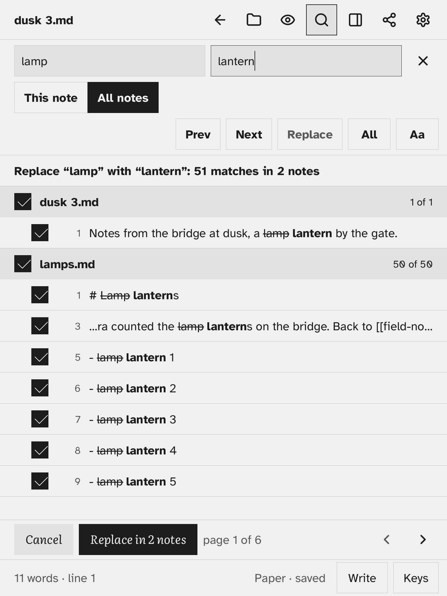
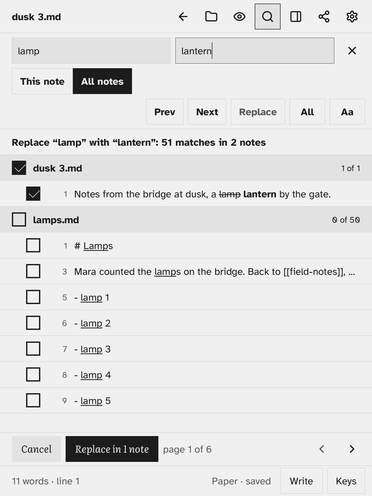

# Replace in all notes

1. Open **Find**, tap **All notes** and type what to look for.
2. Tap the **Replace** field and type the new text. Leave it empty to delete the matches.
3. Tap **All**. Nothing changes yet: a review sheet takes the place of the results list.

The single **Replace** key stays grey in All notes. Across notes, every change goes through the review sheet.

## The review sheet

- The line on top says what will change and how much: "Replace “lamp” with “lantern”: 52 matches in 3 notes".
- Each note has a row with a tick box and how many of its matches are ticked. Under it, each matching line shows the old text struck out and the new text in bold.
- Tap a note row to tick or untick all its matches. Tap a line to tick or untick that line.
- Matches inside a `[[link]]` are marked **link**, next to the line number, and start unticked, so links are not changed by accident. Replacing one changes only the text of the link; no note is renamed.
- While any link match is unticked, a line under the header says how many: "2 in [[links]], unticked: tap a line to include them". If every match is in a link, the button stays grey until you tick one.
- A tap on a line, or on a note row, includes its link matches only when they are the only matches there. On a line or note that also has plain matches, the tick leaves its links alone; to change those, replace the plain ones first, or edit the link by hand.
- Turn pages with the page buttons. The keyboard is hidden while the sheet is up.
- **Replace in N notes** applies the ticked changes. **Cancel**, Esc or Back go back to the results as they were.

## While it runs

The sheet shows "Replacing… 2 of 3 notes". Taps and keys wait until it is done.

- Before any note is changed, a copy of each one is put aside in the Trash folder, so the replace can be [undone](undo-a-replace.md).
- Each note is written in one step: if the Kobo loses power, the note is either as it was or fully replaced, never half written.
- A note that changed after you reviewed it (you typed in it, or Sync brought a newer copy) is left as it is.
- The open note changes like an edit: Undo in the editor takes the whole replace back for that note.

When it is done, a band above the results says "Replaced 52 in 3 notes · Undo", and how many notes were left alone, if any.

## What is changed

The same notes [Search all notes](search-all-notes.md) looks in: not the Trash, not the handwriting folder (`.ink/`), not hidden files. Inside a note, the address part of a Markdown link or picture, such as `(.ink/note/ink-001.svg)`, is never changed. Text in code is replaced like any other text.

Case follows the **Aa** option. There are no regular expressions and no whole-word matching.
