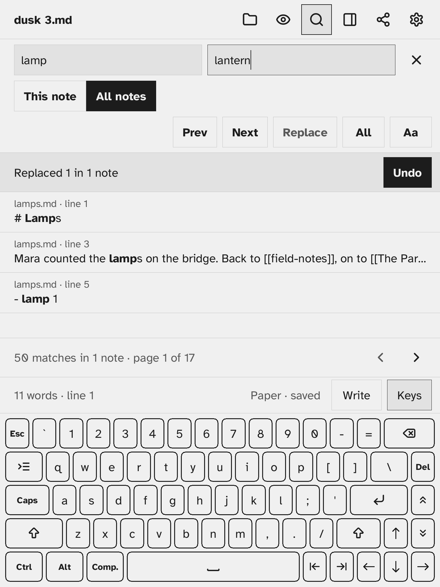

# Undo a replace

After a replace in all notes, tap **Undo** in the band above the results ("Replaced 52 in 3 notes · Undo").

Later, even after restarting Σscribe, open **Find** and tap **All notes**: while the last replace can still be undone, the band offers **Undo last replace**.

## What comes back

- Each note goes back to how it was before the replace.
- A note you edited after the replace is left alone, so your newer writing is never lost. The band says how many notes were left alone.
- The open note changes like an edit, so Undo in the editor can take it back again.

Only the most recent replace can be undone. Once it is undone, Undo is no longer offered, not even for an older replace.

## Where the copies are

The copies are kept in the Trash folder, in `.trash/replace-<date and time>/`. They are not listed on the Trash screen. **Empty trash** removes them, and after that the replace can no longer be undone.

## In one note

Replace in **This note** is undone with Undo in the editor, as any other edit.
