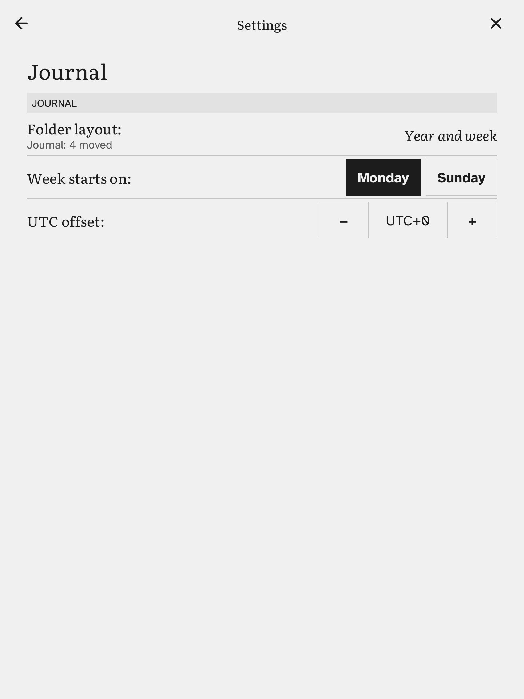

# Folder layout and UTC offset

## Settings → Journal

| Setting | What it does |
|---|---|
| Folder layout | Where the notes sit. **One folder**: `journal/2026-11-02.md`. **Year and month**: `journal/2026/11/2026-11-02.md`. **Year and week**: `journal/2026/W45/2026-11-02.md`, with ISO weeks (Monday to Sunday, week 1 holds the year's first Thursday), so a day in late December can be filed under the next year's `W01`. |
| Week starts on | **Monday** or **Sunday**. Only the calendar's columns change; the weeks in the folder names stay ISO. |
| UTC offset | Whole hours, from −12 to +14. The Kobo does not tell Σscribe its time zone, so set it by hand, and change it when summer time starts or ends. |

### Changing the folder layout

Choosing another layout **moves the notes you already have** to the new folders. A line under the Folder layout row says how many were moved, skipped or failed.

- A file already at the new place is never overwritten; that note is skipped and stays where it was.
- Folders left empty by the move are removed. Other files in them stay.
- `[[links]]` written with a path are updated to the new path. A link by name, `[[2026-11-02]]`, keeps working.

The notes are plain files, so Sync ([sync.md](../10-wifi-and-sync/sync-with-syncthing.md)) and a computer over USB see the same folders.
