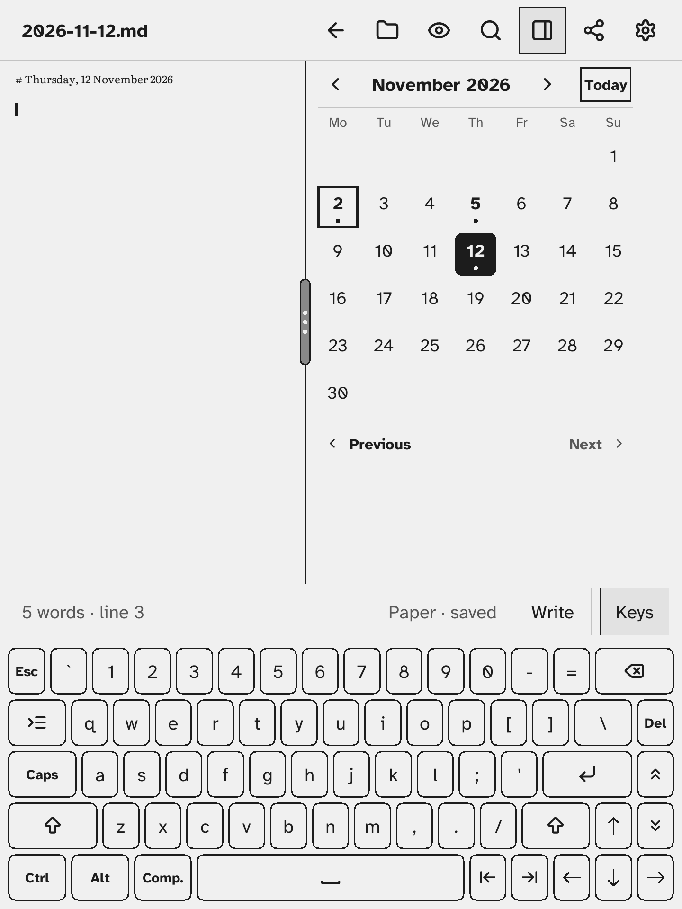

# Today's note

The journal is one Markdown note per day, kept in the `journal/` folder of your notes and named by date: `2026-11-02.md`. You open or make a day's note from the **Calendar** pane in the side drawer.

A new note holds a heading with the long date, in the language of the app: `# Monday, 2 November 2026`.
