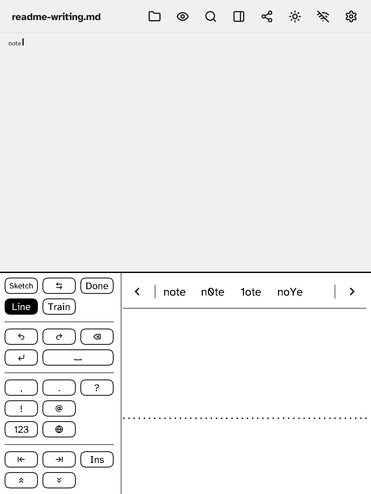

# The Write panel

Tap **Write** (next to Keys, at the bottom of the note) to write with a finger or stylus instead of typing. What you write is read and typed into the note at the caret. The panel works in four modes: **Write**, **Letter boxes**, **Train** and **Sketch**.

## The layout

The panel fills the bottom of the screen. The **keys are in one block**, about a third of the width, on one side; the other two thirds are the **writing area**, full height. A **candidate bar** runs along the top of the writing area.

The keys are in groups, divided by a thin line. Which groups there are depends on the mode:

| Mode | Groups, top to bottom |
|---|---|
| Write | Panel: **Sketch**, **⇄**, **Done**; **Line**, **Train**. Editing: Undo, Redo, **Erase** (backspace); **Return**, **Space**. Typing: `,` `.` `?` `!` `@`; **123** (digits and signs); the language key (the globe). Moving: Home, End, **Ins** (insert or overwrite); Page up, Page down. |
| Letter boxes | The same, without the typing group. |
| Train | **⇄**, **Done**; **Line**. Then Undo, **Skip**, **Save**. No Sketch, Train, editing, typing or moving keys. |
| Sketch | **Write** (back to writing), **⇄**, **Cancel**; **Line**. Then Undo, **Clear**, the pen key (**Finger** or **Stylus**); **Insert**. There is no Train key. |

- **⇄** moves the key block to the other side. Use it to keep your hand off the keys while you write; it is remembered.
- **Line** shows or hides the dotted **guide line** in the writing area. Write on it, or ignore it; it is also remembered.
- **Done** closes the panel (in Train it goes back to Write or Letter boxes; in Sketch the key is **Cancel**, which leaves the sketch without inserting it).

## Good to know

- The panel works in portrait and landscape.
- The pen is in Settings → Keyboard & input → Handwriting. **Fast ink (A2)**, a quicker e-ink waveform for the ink, is there too, but only shows when **Experimental features** (its own category in Settings) is on.
