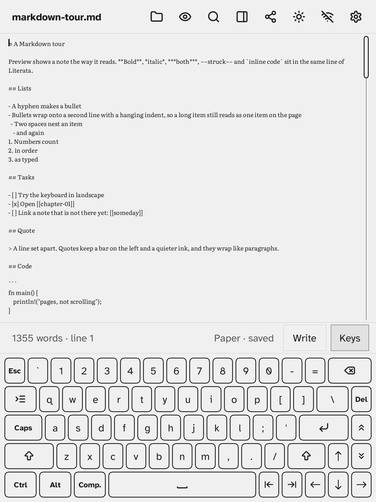
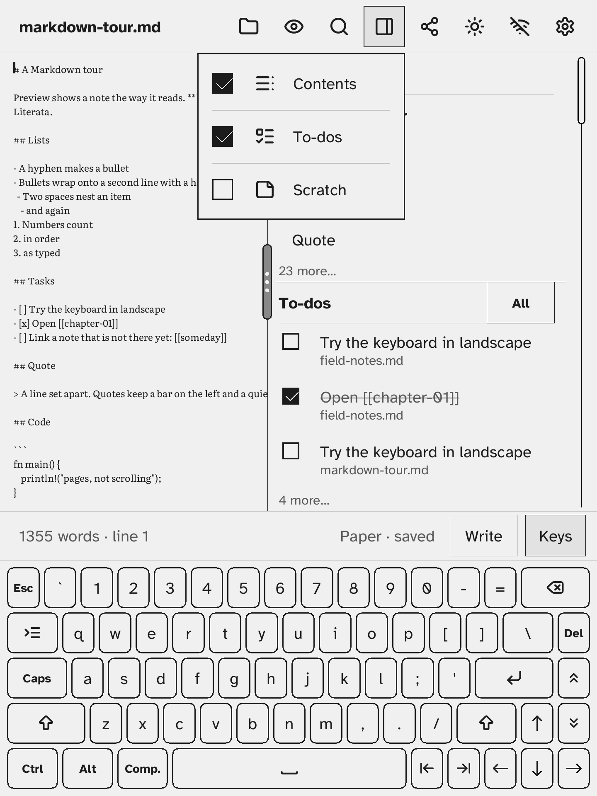

# Getting started

A short tour of Σscribe on the Kobo. Installing it is in [install.md](install.md).

## Open it

On the Kobo, open the NickelMenu and tap *Σscribe*. The stock reader stops while Σscribe runs; leaving the app (the power button) saves your note and brings the reader back.

Your notes are plain `.md` files in `sigma-scribe/notes` on the Kobo drive, so a computer can read them over USB (or by [Sync](sync.md)).

## The title bar

The note's name is at the left. The buttons, left to right:

| Button | What it does |
|---|---|
| Folder | **Files**: your notes and folders. New note, New folder, a note's More (Rename, Move, Delete), and the **Trash**, where a deleted note waits until you restore it or empty the Trash. |
| Eye / pencil | Switches between **Write** (the text, with the keyboard) and **Preview** (the note as it reads, in pages you turn with the page buttons). |
| Magnifier | **Find** and replace in the note. |
| Panel | The **drawer menu**: tick Contents, To-dos or Scratch to open that pane beside the note. Drag the drawer's grip to change its width; double tap it to tuck the drawer away. |
| Share symbol | The **Graph**: your notes and the `[[links]]` between them, as a map or a list. |
| Sun | The **front light** menu: Backlight and Warmth. Only on a Kobo with a front light. |
| Wi-Fi | Turns Wi-Fi on and off and joins a network. See [wifi.md](wifi.md). |
| Cog | **Settings**. |

## Writing

- At the bottom of the screen, **Keys** shows or hides the on-screen keyboard and **Write** opens the handwriting panel ([handwriting.md](handwriting.md)). A USB keyboard works too ([usb-keyboard.md](usb-keyboard.md)).
- Notes save by themselves. The line above the keyboard shows the word count and "saved".
- Link to another note with `[[its name]]`; a dashed link makes the note when you open it.
- Tasks written as `- [ ]` are listed, for all your notes, in the To-dos pane, where you can tick them off.

## Settings

The cog opens Settings: Writing (font, size, margins), Display (Paper or Night, UI scale, drawer, backlight and warmth, orientation), Keyboard & input (keyboard, layout, handwriting), Language, USB & devices, Plugins, Logging, Sync and Help & about. Changes apply at once and are kept.

## Quitting

Press the power button. Σscribe saves the note and the settings, and the Kobo goes back to the normal reader.
