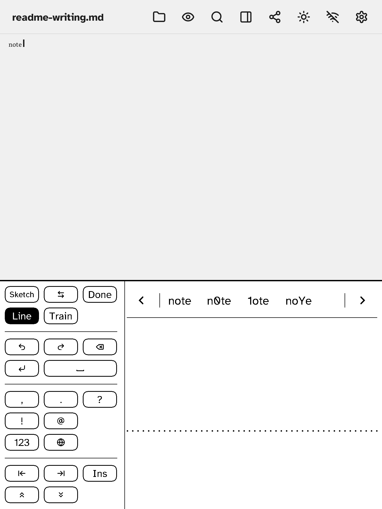

# Handwriting (the Write panel)

Tap **Write** (next to Keys, at the bottom of the note) to write with a finger or stylus instead of typing. What you write is read and typed into the note at the caret. The panel works in four modes: **Write**, **Letter boxes**, **Train** and **Sketch**.

## The layout

The panel fills the bottom of the screen. The **keys are in one block**, about a third of the width, on one side; the other two thirds are the **writing area**, full height. A **candidate bar** runs along the top of the writing area.

The keys are in groups, divided by a thin line. Which groups there are depends on the mode:

| Mode | Groups, top to bottom |
|---|---|
| Write | Panel: **Sketch**, **⇄**, **Done**; **Line**, **Train**. Editing: Undo, Redo, **Erase** (backspace); **Return**, **Space**. Typing: `,` `.` `?` `!` `@`; **123** (digits and signs); the language key (the globe). Moving: Home, End, **Ins** (insert or overwrite); Page up, Page down. |
| Letter boxes | The same, without the typing group. |
| Train | **⇄**, **Done**; **Line**. Then Undo, **Skip**, **Save**. No Sketch, Train, editing, typing or moving keys. |
| Sketch | **Write** (back to writing), **⇄**, **Cancel**; **Line**. Then Undo, **Clear**, the pen key (**Finger** or **Stylus**); **Insert**. There is no Train key. |

- **⇄** moves the key block to the other side. Use it to keep your hand off the keys while you write; it is remembered.
- **Line** shows or hides the dotted **guide line** in the writing area. Write on it, or ignore it; it is also remembered.
- **Done** closes the panel (in Train it goes back to Write or Letter boxes; in Sketch the key is **Cancel**, which leaves the sketch without inserting it).

## Write (free writing)

Print letters anywhere in the writing area. Σscribe splits the ink into letters, reads them, and types the word into the note when you pause. Spaces come from the gaps between letters.

The candidate bar shows the other readings of the last word. Tap one to replace what was typed. The arrows page through more.

- **Word mode** (Settings → Keyboard & input → Handwriting; it shows only with Settings → Experimental features on) reads whole words against a word list and the words in your notes. It suits joined-up writing.
- **Learn from corrections** (same place): when you fix a letter by picking a candidate, Σscribe keeps that ink as a sample of how you write that letter.

### Gestures

In the writing area:

- **Scratch out** (a zig-zag back and forth over ink): deletes it. With no ink waiting to be read, it deletes the last word you typed instead.
- **Flick left** (a long, flat stroke from right to left): Backspace.
- **Flick right** (a long, flat stroke from left to right): Space.

A tap on the note above the panel moves the caret there; the panel stays open.

## Letter boxes

Settings → Keyboard & input → Handwriting → **Letter boxes** gives one character per box instead of free writing. Write a letter in a box; a moment after you lift, it is read and the next box is ready. It is steadier for tricky letters and for languages with many look-alike characters. The key block is the same as in Write, minus the typing group.

## Train

Train teaches the recogniser your handwriting. It shows a character; write it in the box and tap **Save** (or **Skip** to leave it), and the next one comes up. Open it from the **Train** key (in Write or Letter boxes), or from Settings → Keyboard & input → Handwriting → My handwriting → Train. *Delete* in the same place removes the samples. The samples are kept in the notes folder under `.handwriting`.

## Sketch

**Sketch** turns the writing area into a drawing pad. Draw with a finger or a stylus (the pen key chooses), then tap **Insert** to put the drawing into the note, where Preview shows it. Undo takes back a stroke, Clear removes the drawing, **Line** shows the guide for lettering. **Write** goes back to writing.

## Good to know

- The panel works in portrait and landscape.
- The pen is in Settings → Keyboard & input → Handwriting. **Fast ink (A2)**, a quicker e-ink waveform for the ink, is there too, but only shows when **Experimental features** (its own category in Settings) is on.
- Other scripts (Arabic, Japanese, Chinese and so on) are typed with a layout rather than written. The Asian, right-to-left and Indic layouts only appear in the layout list when Settings → Experimental features is on; see [japanese.md](japanese.md), [chinese.md](chinese.md) and the layouts in Settings.
