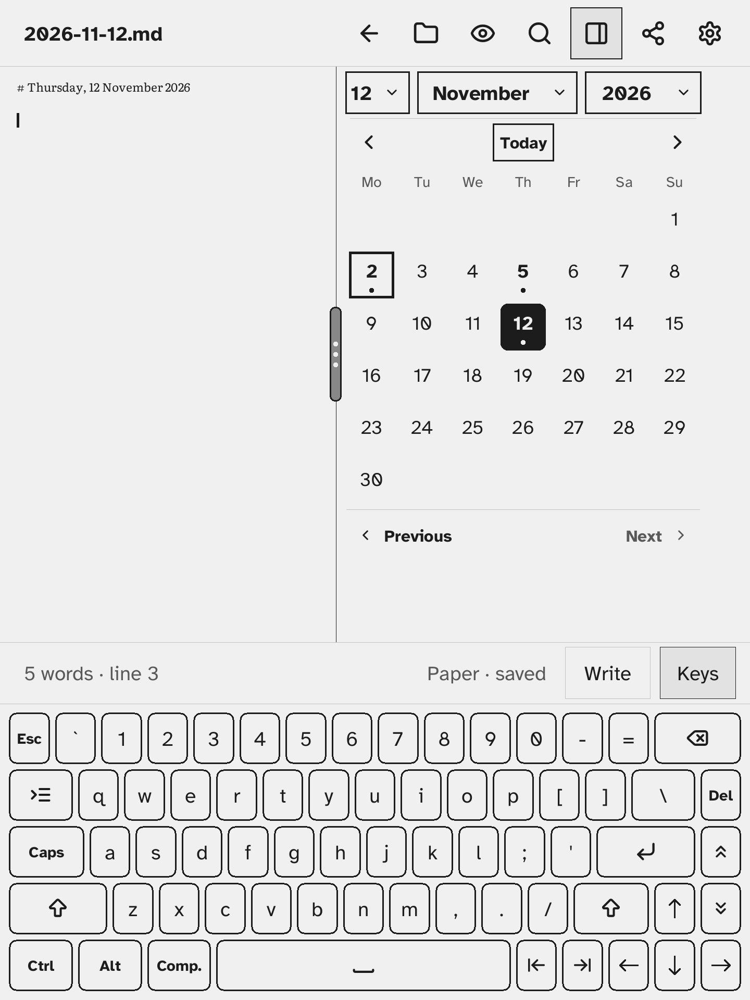
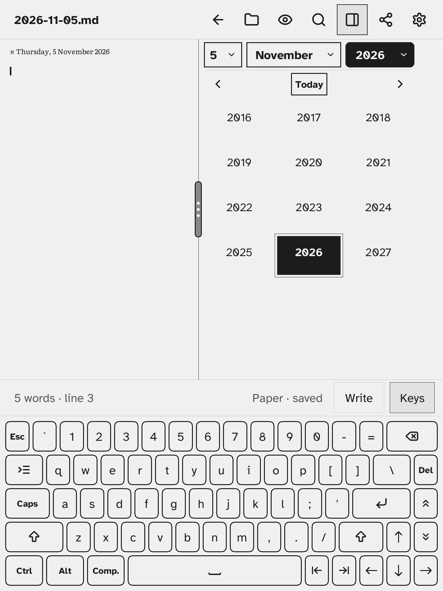
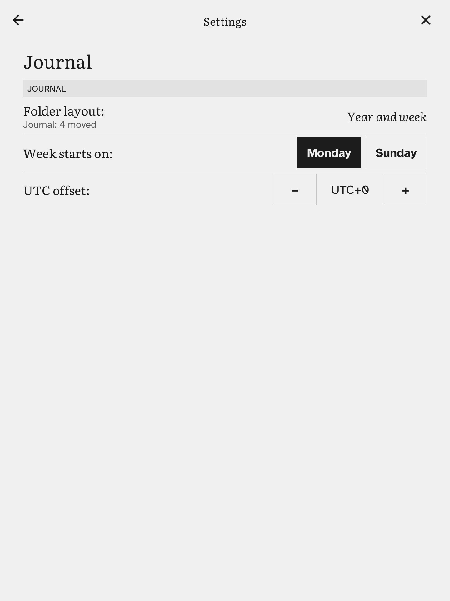

# Journal

The journal is one Markdown note per day, kept in the `journal/` folder of your notes and named by date: `2026-11-02.md`. You open or make a day's note from the **Calendar** pane in the side drawer.

## The Calendar pane

Tap the **panel** button in the title bar and tick **Calendar**, as for Contents, To-dos and Scratch ([getting-started.md](getting-started.md)). Calendar is part of the app, not a plugin, so it has no switch in Settings → Plugins, and the panel button stays even when every pane plugin is off.

- The pane starts with a **date line** of three buttons, day, month and year (`2  November  2026`), and below it a row with **‹**, **Today** and **›**. The pane shows one month. **‹** and **›** change the month; **Today** goes back to the current month and opens today's note.
- Today has an outline. A day with a note has a dot under its number. The note that is open is filled.
- Tap a day to open its note. If there is none yet, it is made.
- While a journal note is open, **Previous** and **Next** at the bottom of the pane go to the neighbouring notes (the nearest earlier and later days that have one).
- **Back** (the arrow in the title bar) returns to the note you came from.

If the Kobo's clock has not been set, the pane says "Clock not set" and has no today.

### The date line

The three fields jump to a date quickly. The month and the year show the month on view; the day is the open note's day when it is in that month, else today's, else the 1st.

- Tap a field and its **picker** takes the place of the weekday row and the grid (the field is filled while its picker is open). Tap the same field again to close the picker; tap another field to switch to its picker.
- **Day**: the numbers 1 to the end of the month. Tapping one opens that day's note, or makes it, as in the grid, and closes the picker. Days with a note are bold with a dot, today is outlined and the open note is filled.
- **Month**: the twelve month names; tapping one shows that month (the year stays). Today's month is outlined.
- **Year**: twelve years at a time, with **‹** and **›** paging twelve years back or forward while it is open. Tapping a year shows that month of that year.
- **Today** also closes a picker. Closing the drawer or switching Calendar off forgets it.

## A new day's note

A new note holds a heading with the long date, in the language of the app: `# Monday, 2 November 2026`. To start from your own text, put a note named `.template.md` in the `journal/` folder. When a day's note is made, `{{date}}` in the template becomes the date as `2026-11-02` and `{{title}}` the long date. A note that already exists is never overwritten.

## Settings → Journal

| Setting | What it does |
|---|---|
| Folder layout | Where the notes sit. **One folder**: `journal/2026-11-02.md`. **Year and month**: `journal/2026/11/2026-11-02.md`. **Year and week**: `journal/2026/W45/2026-11-02.md`, with ISO weeks (Monday to Sunday, week 1 holds the year's first Thursday), so a day in late December can be filed under the next year's `W01`. |
| Week starts on | **Monday** or **Sunday**. Only the calendar's columns change; the weeks in the folder names stay ISO. |
| UTC offset | Whole hours, from −12 to +14. The Kobo does not tell Σscribe its time zone, so set it by hand, and change it when summer time starts or ends. |

### Changing the folder layout

Choosing another layout **moves the notes you already have** to the new folders. A line under the Folder layout row says how many were moved, skipped or failed.

- A file already at the new place is never overwritten; that note is skipped and stays where it was.
- Folders left empty by the move are removed. Other files in them stay.
- `[[links]]` written with a path are updated to the new path. A link by name, `[[2026-11-02]]`, keeps working.

The notes are plain files, so Sync ([sync.md](sync.md)) and a computer over USB see the same folders.
